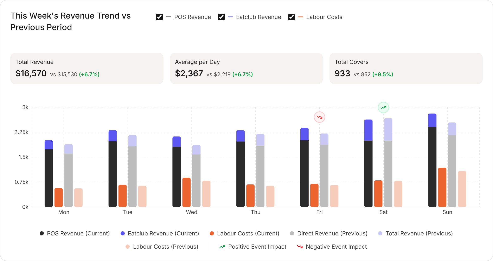
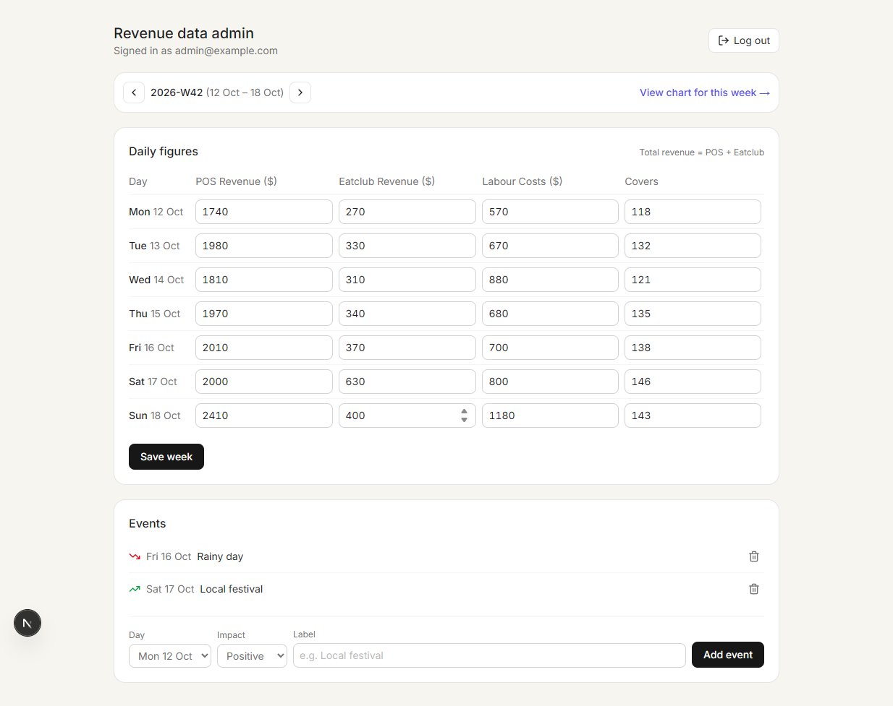

# Revenue Trend Demo

A weekly **Revenue Trend** chart card (POS revenue, Eatclub revenue, labour costs, events, compare
with previous week, export to PNG), an **admin area** to enter the data, and a **Node.js API**
in between. The chart always shows exactly what the admin saved.



| Part | Stack | Port |
|------|-------|------|
| `frontend/` | Next.js 15 (App Router, TypeScript, Tailwind), Recharts, html-to-image | 3000 |
| `backend/` | Node.js, Express 5, Prisma 6, JWT (httpOnly cookie), bcrypt | 4000 |
| `docker-compose.yml` | PostgreSQL 16 | 5432 |

The frontend proxies `/api/*` to the backend, so the browser only talks to `localhost:3000`.

---

## 1. Install the prerequisites (fresh machine)

You need **Git**, **Node.js 20.6+** (22 LTS recommended) and **Docker** (with Compose).
Skip anything you already have.

### macOS

```bash
# Homebrew (package manager)
/bin/bash -c "$(curl -fsSL https://raw.githubusercontent.com/Homebrew/install/HEAD/install.sh)"
# follow the "Next steps" Homebrew prints to add brew to your PATH, then:

brew install git
brew install --cask docker-desktop   # or download Docker Desktop from https://www.docker.com
open -a Docker               # start it once and wait until it says "Docker Desktop is running"
```

### Linux (Ubuntu / Debian)

```bash
sudo apt update
sudo apt install -y git curl ca-certificates

# Docker Engine + Compose plugin
curl -fsSL https://get.docker.com | sudo sh
sudo usermod -aG docker "$USER"
newgrp docker                # or log out and back in, so docker works without sudo
```

### Node.js (macOS and Linux) via nvm

```bash
curl -o- https://raw.githubusercontent.com/nvm-sh/nvm/v0.40.3/install.sh | bash
# open a new terminal (or: source ~/.nvm/nvm.sh), then:
nvm install 22
```

Check everything is ready:

```bash
git --version
node -v                 # v22.x
docker compose version  # v2.17+ (needed for --wait)
```

## 2. Get the code

```bash
git clone <repository-url> revenue-trend-demo
cd revenue-trend-demo
```

## 3. Start the database

```bash
docker compose up -d --wait db
```

This starts PostgreSQL 16 with user `revenue`, password `revenue`, database `revenue_trend`
(data is kept in the `pgdata` Docker volume).

## 4. Backend: install, migrate, seed, run

```bash
cd backend
cp .env.example .env
# replace the placeholder JWT secret with a random one (works on macOS and Linux)
sed -i.bak "s/^JWT_SECRET=.*/JWT_SECRET=$(node -e "console.log(require('crypto').randomBytes(32).toString('hex'))")/" .env && rm .env.bak
npm ci                   # also generates the Prisma client
npm run db:migrate       # creates the tables (prisma migrate deploy)
npm run db:seed          # admin account + sample data from last week to 3 weeks ahead
npm run dev              # API on http://localhost:4000
```

Leave this terminal running. The API refuses to start if `JWT_SECRET` is empty.

The seed only **creates what is missing**: running it again never overwrites numbers or events
you edited in the admin. If you open the demo more than ~3 weeks later, run `npm run db:seed`
again to add sample data for the new weeks.

## 5. Frontend: install and run

In a **second terminal**, from the project root:

```bash
cd frontend
cp .env.example .env.local
npm ci
npm run dev              # app on http://localhost:3000
```

## 6. Use it

| What | URL |
|------|-----|
| Chart (current week) | http://localhost:3000 |
| Chart for a given week | http://localhost:3000/?week=2026-W41 |
| Admin login | http://localhost:3000/admin/login |

Admin credentials (from the seed): **`admin@example.com` / `admin123`**
(change them with `ADMIN_EMAIL` / `ADMIN_PASSWORD` in `backend/.env`, then run `npm run db:seed` again;
this updates the admin account and leaves your data alone).

In the admin you can switch week, edit the 7 days (POS, Eatclub, labour, covers), save, and
add/delete events. Open the chart again (or click **View chart for this week**) and it shows the
saved numbers.



---

## Running the tests

```bash
cd backend
npm test
```

Unit tests (Node's built-in test runner) cover ISO-week maths (including the 2026 → 2027
53-week boundary), summary / percentage calculation, Decimal → number serialization,
timezone safety, input validation (including values too large for the database columns),
the 401 / 400 responses and the missing-`JWT_SECRET` startup check. They do not need the database.

## Database migrations

- Apply existing migrations: `cd backend && npm run db:migrate`
- After changing `backend/prisma/schema.prisma`, create a new migration:
  `cd backend && npx prisma migrate dev --name <what-changed>`
- Start from an empty database: `docker compose down -v && docker compose up -d --wait db`,
  then `npm run db:migrate && npm run db:seed` in `backend/`.

## API

| Method | Path | Auth | Description |
|--------|------|------|-------------|
| GET | `/api/revenue-trend?week=YYYY-Www` | – | Current + previous week (7 days each), events, summary. `week` defaults to the current ISO week |
| POST | `/api/auth/login` | – | `{ email, password }` → sets an httpOnly JWT cookie (7 days) |
| POST | `/api/auth/logout` | – | Clears the cookie |
| GET | `/api/auth/me` | admin | Logged-in admin's email |
| GET | `/api/admin/weeks/:week` | admin | The week's 7 days and events |
| PUT | `/api/admin/weeks/:week/days` | admin | `{ days: [7 × { date, posRevenue, eatclubRevenue, labourCosts, covers }] }` |
| POST | `/api/admin/events` | admin | `{ date, impact: "positive" \| "negative", label }` |
| DELETE | `/api/admin/events/:id` | admin | Remove an event |

Errors are JSON `{ "error": "message" }` with status 400 (invalid input), 401 (not logged in) or 404.

## How the numbers are calculated

- **Total revenue** = POS revenue + Eatclub revenue, summed over the 7 days (Mon–Sun, ISO week).
- **Average per day** = total revenue ÷ 7.
- **Total covers** = sum of covers.
- **Change %** compares with the previous ISO week; it shows "—" when the previous week has no data.
- Money is stored as `NUMERIC(12,2)` in PostgreSQL (no floating-point drift); dates as `DATE`, all
  date maths in UTC.

## Notes

- The reference video re-randomizes the numbers on every toggle (a mock). Here the data is stable
  and comes from the database, so the chart only changes when the admin saves.
- On phones the header controls wrap, KPI tiles stack and the chart scrolls horizontally inside
  the card instead of squeezing 28 bars into 375px.
- Only one admin role is implemented; there is no sign-up, by design.

## Troubleshooting

- **`port 5432 is already allocated`** — another PostgreSQL is running. Stop it, or change the
  host port (the middle `5432`) of `"127.0.0.1:5432:5432"` in `docker-compose.yml` and the port in `backend/.env` `DATABASE_URL`.
- **Port 3000 or 4000 in use** — run the frontend with `npm run dev -- -p 3001`; for the backend
  set `PORT` in `backend/.env` and `BACKEND_URL` in `frontend/.env.local` to match.
- **Chart shows "Could not load revenue data"** — the backend is not running, or
  `BACKEND_URL` in `frontend/.env.local` points to the wrong port.
- **`docker: permission denied` on Linux** — run `newgrp docker` or log out and back in after
  `usermod -aG docker`.
